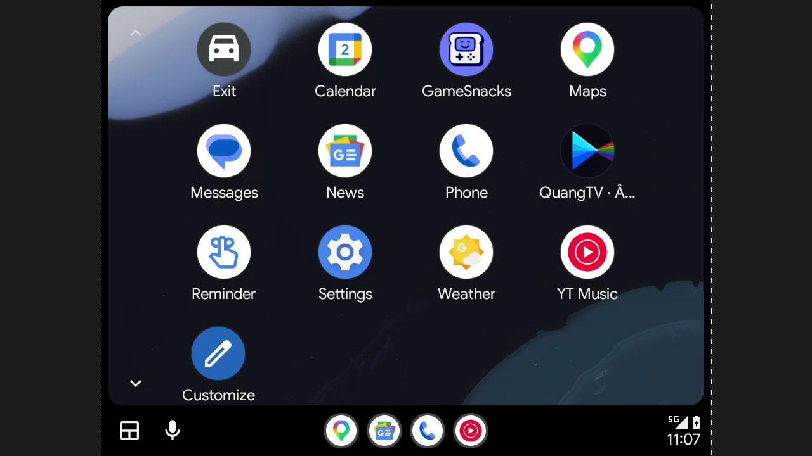
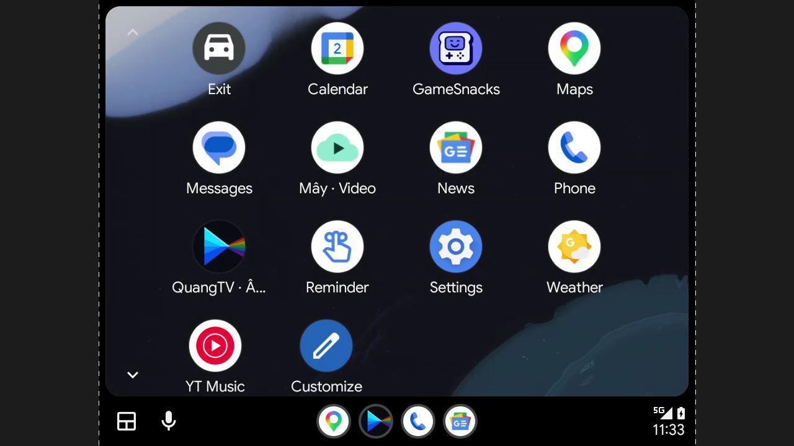
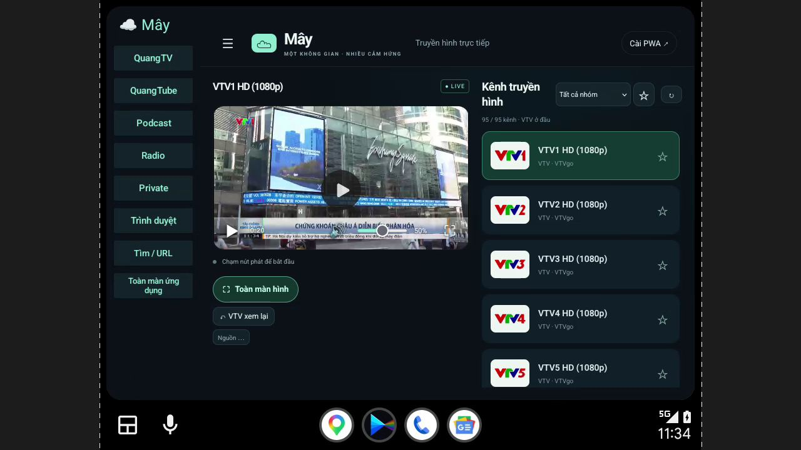

# Build 24: audio repair and video admission

Source `f2398cbc835a804a148c1b2719dd6598edf3f767`; [successful CI](https://github.com/Quangdevil/QuangTV/actions/runs/41386374569). Exact arm64 APK SHA256: `13d17d9c8219e951b7017ef9740980f1f900bc71749908d7fd06abba81132e17` (122718522 bytes).

## Fixes verified

Android MediaBrowser previously returned null for an individual channel. The audio handler now supplies catalog metadata and orders VTV numerically first, including cached catalogs. AGP resource shrinking also removed dynamically named audio_service playback icons; those resources are explicitly kept and checked in the packaged APK. The native MediaBrowser probe on build 24 returned 95 channels, VTV1 first, valid VTV1 metadata, PLAYBACK=3 and queue size 1, with zero missing-icon exceptions. Stale channel resolutions cannot replace the current source. Audio UI remained stable during the preceding build 23 runtime check.

## Why the earlier DHU test missed this

The standard Google/Desktop Head Unit identity receives developer treatment. Release application mode alone did not test consumer admission. Earlier reports also assumed Unknown sources remained enabled; inspection found it disabled after setup reselected Release. Setup now preserves the existing mode, and the consumer comparison explicitly enabled Unknown sources.

A private copy of the desktop head-unit executable changed only its advertised model from `Desktop Head Unit` to the same-length `Consumer HeadUnit`. Android Auto and the APK were not patched. This removes the standard model exemption in this test, but is still DHU, not a Samsung phone or VF8 head unit.

With ordinary installation, build 24 logs rejected its native projection entry; only the audio path was available. Build 23 also captured the audio-only launcher shown below. Installing the EXACT SAME build 24 APK through official KingInstaller 2.5 Classic, with Root and Shizuku OFF, changed provenance from shell/no installer to initiating `com.google.android.packageinstaller`, installing `com.android.vending`. Reading the installed base APK confirmed the identical SHA256 above.

After reconnecting this consumer-model head unit, **Mây · Video** appeared alongside **QuangTV · Âm thanh**. Opening Mây showed all six destinations: TV, Tube, Podcast, Radio, Private and Browser. VTV1 played moving video fullscreen within the Android Auto application area. Two full-video-region captures had mean RGB absolute difference 126.86; both were visually inspected. Android Auto navigation remains outside the app. This verifies VTV1, not every channel or every destination's content availability. The existing parked-only gate is retained.

## Installation

Download [build 24](https://github.com/Quangdevil/QuangTV/releases/tag/auto-preview2-build24) and [official KingInstaller 2.5](https://github.com/fcaronte/KingInstaller/releases/tag/2.5). Select this APK in KingInstaller, leave Root/Shizuku OFF, press Install as king and confirm Update. Install over the existing Preview 2; do not uninstall. Reconnect Android Auto and choose the mint cloud **Mây · Video** icon. **QuangTV · Âm thanh** remains an audio-only service. Future APK updates should use this installer route too; the app's own updater is not verified to preserve this provenance.

Actual One UI 9 / VF8 admission remains unconfirmed. This is a preview and does not establish Google approval. No production OTA or merge is part of this release. The browser uses GeckoView with native browser controls; hosted task pages remain web content.
