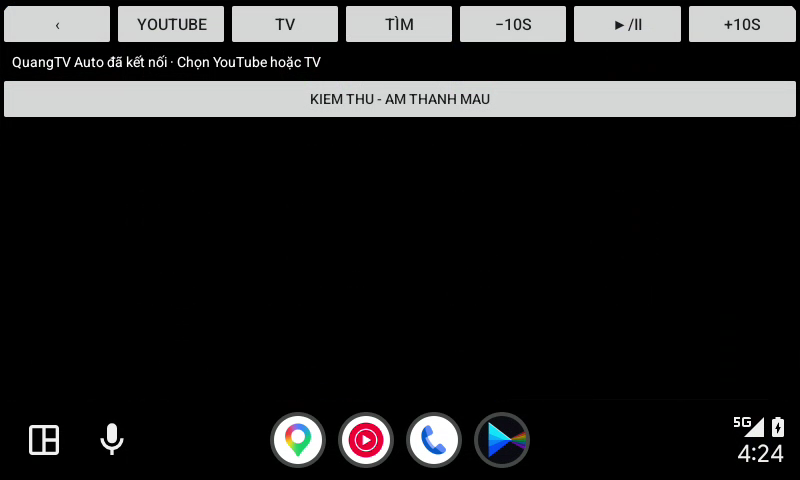
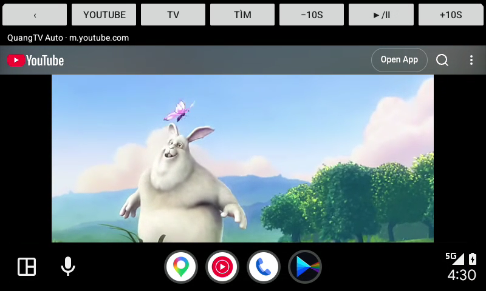

# Android Auto 17.9 DHU runtime verification — 2026-11-01

Tested final source: `92ad1e949058c92c20cd0916e3e8a0bf5b76110f`.
APK: Preview 2 build **11**, versionCode 11, package `com.quangduren.quangtv.autopreview2`.
Build: https://github.com/Quangdevil/QuangTV/actions/runs/41292382422
Artifact: https://github.com/Quangdevil/QuangTV/actions/runs/41292382422/artifacts/13077034702

## Actual runtime environment

Android 17 / API 37 Google Play ARM64 emulator on Apple Silicon; full Google-signed Android Auto **17.9.664044-release**, not AndroidAutoStubPrebuilt. Android Auto Desktop Head Unit **2.0-mac-arm64**, Google SDK build 2022-03-30-438482292, actual ADB projection transport with TLS and 800×480 projected frames. Developer application mode and unknown sources were enabled in this isolated test environment. No personal account was used. This is a developer head unit, so its app admission does not establish acceptance on a production head unit.

## Findings and fixes

Build 9 opened the media browser and showed No items in the fresh installation. The separate projection component was denied by the real AA host:

```
CAR.VALIDATOR: Package DENIED; Uses for PROJECTION not defined [com.quangduren.quangtv.autopreview2]
```

Its descriptor declared only `media`. Adding `projection` alongside `media` made QuangAutoService available as a distinct launcher entry. This was first isolated with a locally re-signed diagnostic APK changing only that resource. The final test below then installed the actual CI-built **build 11 APK**, rather than using the diagnostic APK.

The projection WebView initially inherited the phone's display context and rendered YouTube oversized. Build 11 uses the projected display context and viewport settings. The final UI fit the DHU display.

## Results on the actual build 11 artifact

- PASS: Android Package Manager accepted the in-place update; dumpsys confirmed versionCode 11.
- PASS: QuangAutoService launched from the AA app launcher and rendered the native YouTube / TV / search / playback toolbar.
- PASS: YouTube home rendered at the car display density.
- PASS: AA search opened its keyboard/phone companion input. Submitting **Big Buck Bunny** through the companion input returned the actual YouTube results in the projected WebView. Full on-screen typing on the DHU keyboard was not validated.
- PASS: the official Blender Foundation Big Buck Bunny video played with changing decoded frames on the projected car display.
- PASS: native toolbar pause froze the video region; two separately captured frames were pixel-identical in region `(85,124)-(714,399)`. Resume produced a different video frame. DHU reported audio stream closure on pause and audio start on resume. The host was headless, so speaker output was not listened to.
- PASS: Android crash buffer remained empty through launch, search, video playback, pause and resume.

The labeled **KIEM THU - am thanh mau** channel in the native screenshot is a deterministic test fixture seeded through same-signer instrumentation; it is not user channel data. The playback test above uses actual YouTube content, not that fixture.

Not established: Samsung One UI 9 / VF8 hardware compatibility, every IPTV source, seek/fullscreen controls, or an end-to-end OTA install. The Samsung/car failure reported by the user still needs confirmation on that device. In particular, the earlier private-media-service failure and missing projection capability are separate failure paths.

## Evidence





The displayed video is Big Buck Bunny by the Blender Foundation. Screenshots are retained as runtime test evidence.

Frame comparison result: [runtime-result.json](android-auto-dhu-evidence/runtime-result.json).
Full local log and frame captures are kept under the workspace `.tools/evidence/` directory.

Preview publication is now limited to deliberate workflow dispatch, so compiling a candidate on push does not automatically place an untested APK onto the Preview OTA channel.
