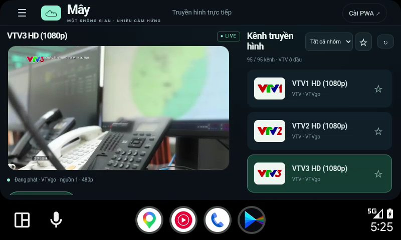
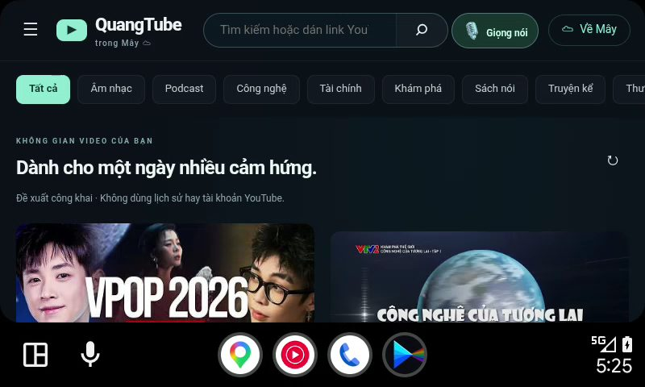
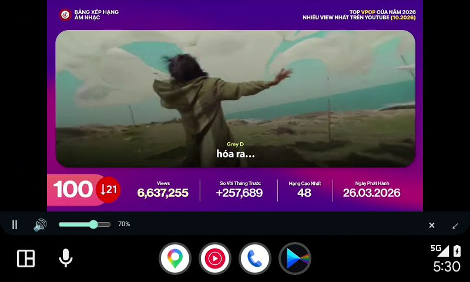

# Mây interface on Android Auto — build 12, 2026-11-01

Tested CI source: `4dd8cd5c1e02858747ed70965a6651c4b286e2c6`.
Run: https://github.com/Quangdevil/QuangTV/actions/runs/41296694023
Artifact: https://github.com/Quangdevil/QuangTV/actions/runs/41296694023/artifacts/13079577453
APK SHA-256: `4f91c840599d6d1b7ba1404fc0a283749f8be58c0803fe7469e3c172aa3b8334`.

## What changed

The projection component renders the current production Mây site directly in
its projected-display WebView. It uses Mây's responsive interface, TV catalog,
fresh VTVgo source resolution and YouTube iframe player. The separate native
seven-button interface and VideoView IPTV path were removed. This is an online
WebView host, not an offline copy of Mây or the phone's Flutter UI.

The Android Auto media browser is still an audio-only entry. Its standard
album-art/player layout cannot display this web interface.

## Environment and install

Android 17 API 37 ARM64 Google Play emulator; Google-signed Android Auto
17.9.664044-release; Google DHU 2.0-mac-arm64 (2022-03-30-438482292), 800×480.
The preview package was uninstalled, then the exact build 12 artifact installed
without seeding preferences or channel fixtures. The phone launcher was opened
once before projection. Android Auto Application Mode was set to **Release**;
AA was force-stopped and the persisted Release value verified after restart.
AA developer options/unknown sources and the DHU head-unit server remain
available. These settings do not turn a DHU into a production vehicle.

## Actual runtime results

- PASS: the distinct projection launcher entry opens the current Mây home and
  TV channel list without importing a phone playlist.
- PASS: real VTV1 video frames changed (mean RGB pixel difference 104.44 in
  the player region); real VTV3 video frames changed (82.13).
- PASS: touch channel selection, fullscreen playback and return to the channel
  list. VTV3 status reported VTVgo / source 1 / 480p; the catalog title 1080p
  is not a claim that the selected adaptive stream decoded at 1080p.
- PASS: Mây menu navigation to QuangTube, actual home recommendations and
  topic search (Công nghệ) returning results.
- PASS: selecting a real YouTube recommendation and tapping the iframe Play
  button rendered changing video frames on the projected display. Mean video
  region difference between playing captures: 80.61.
- PASS: Mây's pause button froze the YouTube video region (two captures were
  byte-identical); resuming changed the video frame again. DHU reported audio
  stream closure on pause and audio start on resume.
- PASS: disconnect/reconnect and reopening the projection entry returned to
  the current Mây home. Initial loading can briefly show black.
- PASS: Android crash buffer remained empty during tested flows.

VTV tests used the page's mute/0% control. The subsequent QuangTube playback
session launched DHU with `SDL_AUDIODRIVER=dummy`; the Android emulator was
also started with `-no-audio`. Speaker output was not listened to. No remote
microphone was opened; voice recognition has not been verified in this host.

## Admission remains unresolved on the user's car

The user reported only the audio entry on their real Samsung/One UI 9 and
vehicle. This did not reproduce on the DHU: even with Application Mode Release,
the projection entry was listed and opened. This result does **not** prove the
APK's projection entry will be admitted on that physical phone/head unit.
Changing web UI cannot repair a host that never lists/calls its projection
service. Build 12 is a tested experimental artifact, not a compatibility claim
or a production OTA update. No installer-identity spoofing, certificate bypass,
rooting or vehicle motion restriction changes are included in the app.

## Screenshots

