# Native Mây browser and Android Auto candidate

Latest findings: [build 24 consumer installation and audio repair](android-auto-consumer-install.md). The previous developer DHU profile did not validate consumer admission; see that report for the corrected method.

Previous tested candidate: **build 21**, source 0508b8e8146217ff5f0e181ae8477e721e3037c4. Its exact CI artifact passed native fullscreen/QuangTube motion, parked-state gate, return-to-menu and URL checks on DHU. Real Samsung/vehicle admission and Google acceptance remain unverified; this is not a completed real-car rollout.

The Auto variant now uses bundled GeckoView 159.0.20261022150525 with native Android browser controls, tab/home/bookmark UI, and a native task rail in the legacy projected activity. It does not use Android WebView for that browser. Websites and the hosted Mây TV/Tube/Podcast/Radio/Private destinations remain web content rendered by Gecko; this is not a rewrite of those destinations as Android widgets.

The normal phone UI remains the current Flutter QuangTV × Mây app synced from main 903a052c4035ab04a35d3463938798b6ace02219. Diagnostics is internal, removing its extra phone launcher icon. A truthful video-category CAR_LAUNCHER alias targets the full phone activity for supported parked hosts. No game-category spoofing or Android Auto host modification is included.

## Build 17 finding

Source c5a53b1fdf752922f060ae1844dd53832e043db7; workflow 41365206063; artifact 13106694838. APK SHA256 b9f296470fcbcf0f1301764c6f9e84190e362a2cc565bafaeb08af53c446b5db.

Clean-installed on Android 17 ARM64 / AA 17.9.664044-release / DHU 2.0 with host GPU and dummy audio. Package manager resolved exactly one normal phone launcher activity and the separate CAR_LAUNCHER alias. DHU showed distinct Mây projection and audio entries. Projection displayed all six task buttons (QuangTV, QuangTube, Podcast, Radio, Private, Trình duyệt); the native browser home and AA search keyboard opened. The CAR_LAUNCHER alias did not appear as a third entry. No real-car admission claim.

Release 17 FAILED content/video verification: the initial Mây page remained loading. Gecko logged Invalid event data for callback. A diagnostic-only, same-signer instrumentation override returning native proxy configuration as JSON text instead of JSONObject allowed the phone Gecko browser to load Mây, 95 TV channels, and a VTV1 frame. That override is not evidence that the unmodified release APK passes. Build 18 applies JSON text serialization and validates it in the extension, retaining fail-closed handling of malformed/missing proxy state.

Phone Flutter home rendered current UI, but the emulator's native VLC moving picture was corrupted; no phone video pass is claimed from that capture. This must not be confused with Gecko's decoder or a confirmed Samsung issue.

## Google and real-vehicle boundary

The official [parked Android Auto guide](https://developer.android.com/training/cars/parked/auto), checked 2026-11-02, still states games are the only generally supported parked category. Google's [video-app announcement](https://developer.android.com/blog/posts/whats-new-in-android-for-cars-unifying-platforms-and-unlocking-premium-experiences) provides an interest form. Adding CAR_LAUNCHER or passing DHU tests is not Google approval or proof that the Samsung/One UI 9 vehicle will expose the video entry. No production OTA is published while this remains unverified.

## Build 18 runtime — unmodified CI APK

Source c8adff7b24640ce1589c8168b5f2bf54e2b94e27; [successful workflow](https://github.com/Quangdevil/QuangTV/actions/runs/41366504956); artifact 13107332675. APK SHA256 a1dfe447a6e1a90d0cc0c887109621a3747a55ea4e782a4626b9e2d44f5b3948.

Uninstalled 17, installed the exact 18 artifact. No seeded catalog, no instrumentation override, and no prior phone Activity launch. Same AA Release/DHU display/host GPU/dummy audio profile. AA developer options, unknown sources and the DHU head-unit server remain enabled; Application Mode Release does not make this a production vehicle or prove host trust. No installer spoofing, root, or host patch is used.

- PASS: Mây home, six native task buttons, 95 live channels.
- PASS: explicit Play, fullscreen VTV1, visually clean changing frames; mean RGB difference 69.26 across the same video region. Fullscreen hides the native rail and browser chrome; Android Auto's bottom navigation and video aspect-ratio bars remain.
- PASS: exit fullscreen, select VTV3; visible video and VTVgo/source 1/480p playing state. The catalog's 1080p title is not a decoded resolution claim.
- PASS: while fullscreen, DHU restrict all + speed 10 replaced the picture with the parked-only gate. speed 0 + restrict none restored access. No spoofed car-state logic is included in the APK.
- PASS: QuangTube recommendations; native AA search accepted the public Blender Big Buck Bunny URL (aqz-KE-bpKQ), the content-script bridge opened its official YouTube player. Play and fullscreen yielded clean changing video; mean RGB difference 72.92. Two actual frames are provided below.
- PASS for UI/playback state: Podcast loaded 80 episodes; selecting the first reached Đang phát. Radio loaded 10 stations; VOV Hà Nội FM91 reached Đang phát with elapsed 0:09. Dummy audio used; no listening claim.
- PASS for entry UI only: Private displayed its PIN setup dialog. No user's PIN, private source, or account was entered. Private data is local to this Gecko profile and is not proven synced with Flutter's private storage.
- PASS: native browser home, then example.org rendered inside Gecko through AA's URL search. Found an incidental-focus bug that reopened AA search after submitting; cancellation revealed the loaded page. Follow-up source 72e2cc5a9585e9fffad6efced87f5eb8761676d8 changes URL keyboard activation to an explicit address tap.
- Android crash buffer empty. Gecko emitted internal session-store warnings when closing sessions; this is not a claim of an error-free JavaScript log.

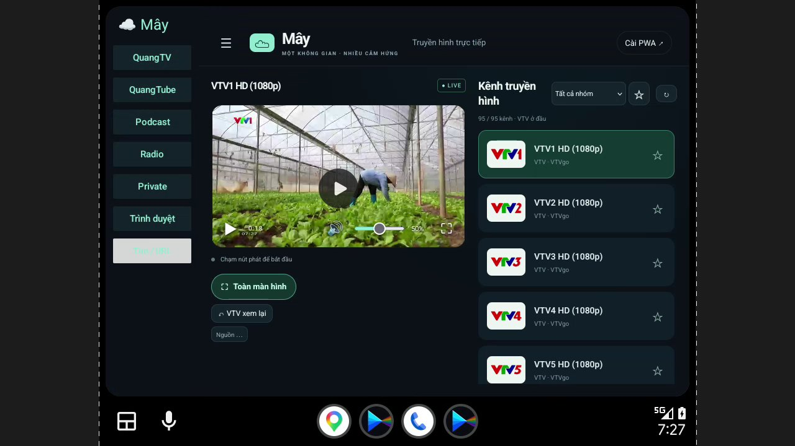
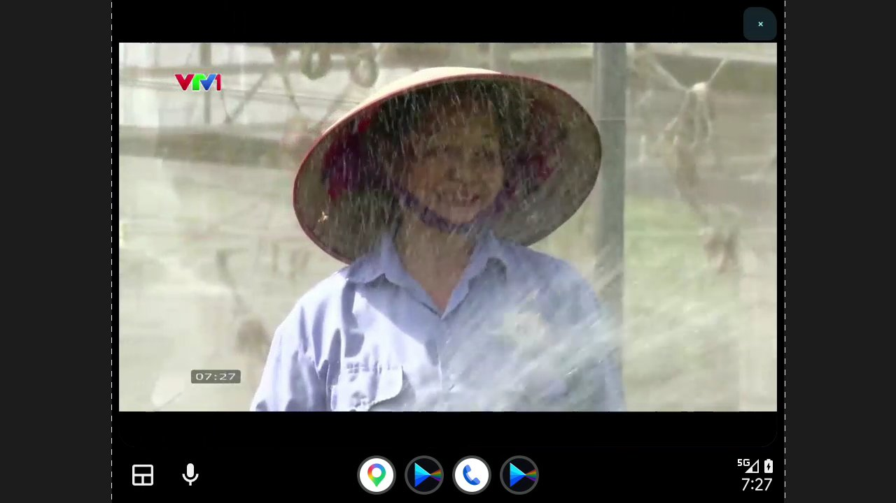
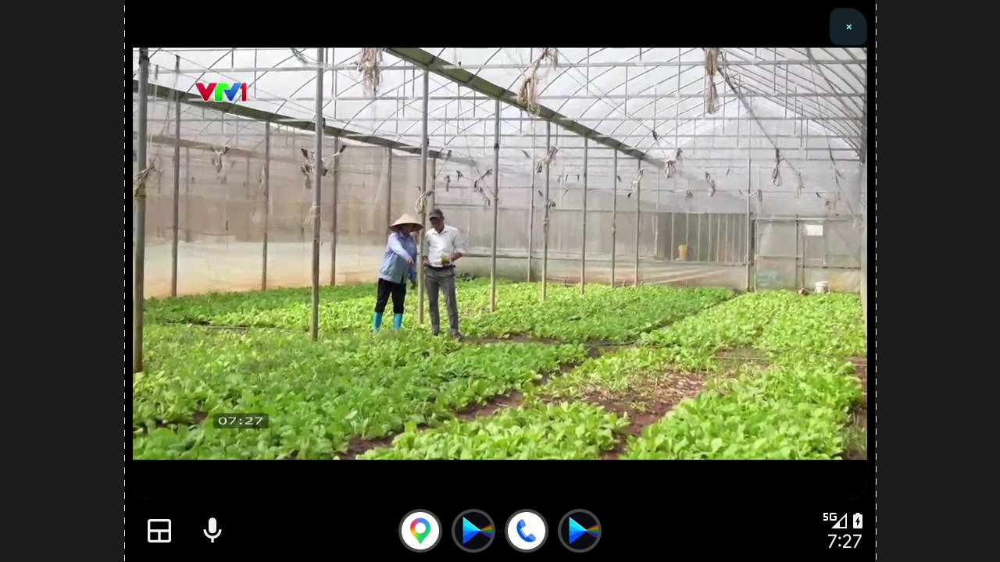
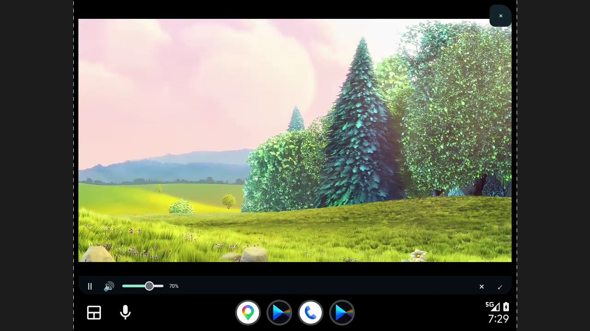
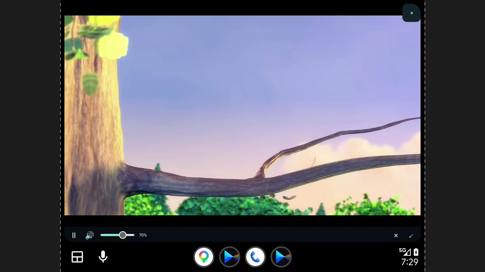
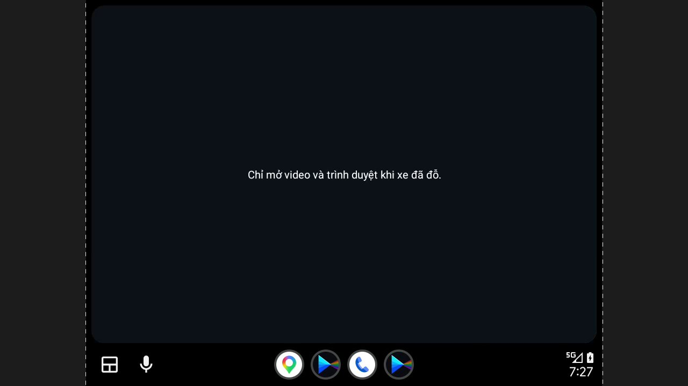
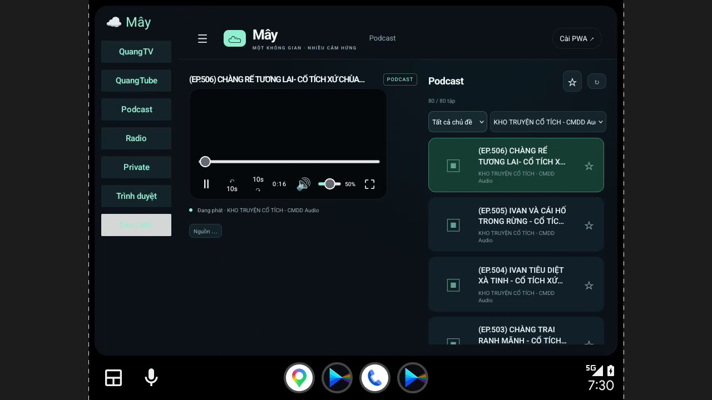
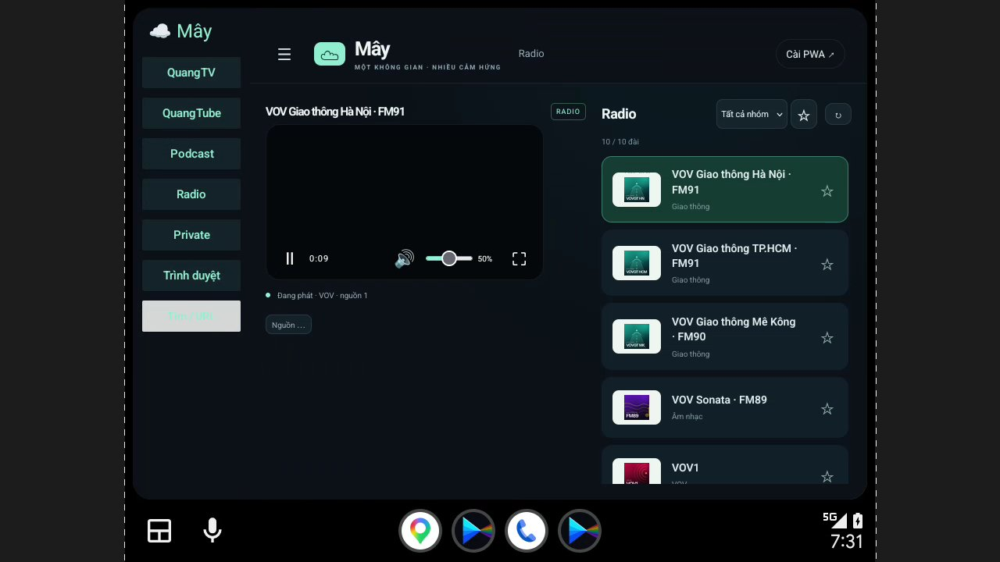
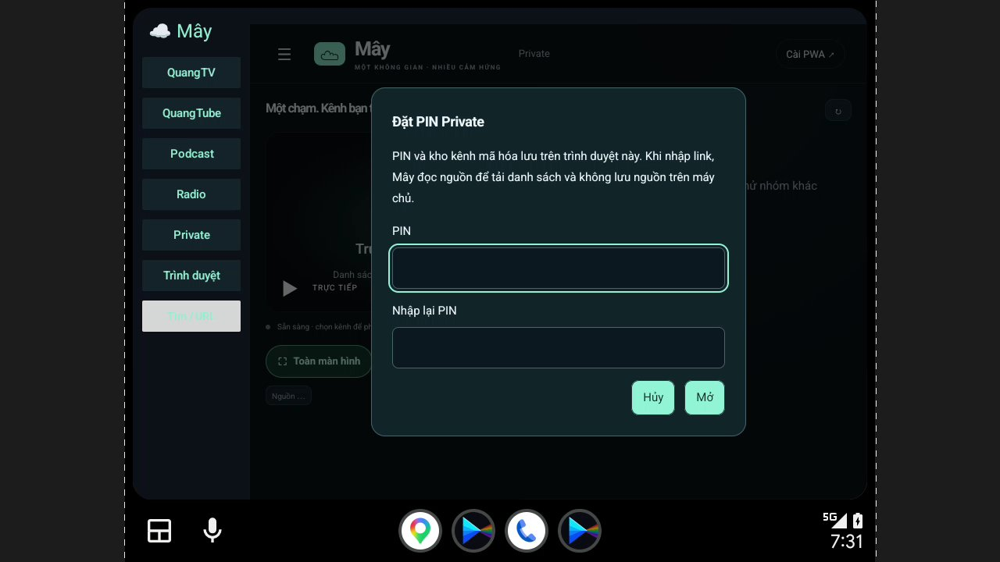
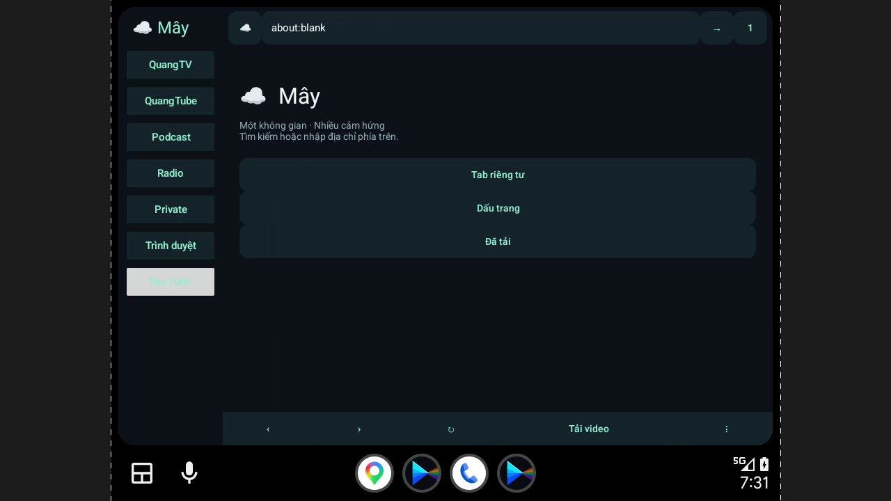

[Machine-readable observations](android-auto-native-evidence/result.json). Real vehicle admission and Google acceptance remain unverified. This is a tested candidate, not a completed real-car rollout.

## Build 20 regression checks

Source f9a3f9bbdf5b175c9e88920cd10abfa1807dd09e; [successful workflow](https://github.com/Quangdevil/QuangTV/actions/runs/41368886179); [artifact 13107974983](https://github.com/Quangdevil/QuangTV/actions/runs/41368886179/artifacts/13107974983). APK SHA256 d1f1bb1280bf5e25f5461386975492d7a1d2fdbe47fb6900e7501249eae7a302.

Build 19 passed CI and an in-place update from 18, with clean moving fullscreen VTV1 (mean RGB difference 62.76) and successful native-browser navigation. It fixed the keyboard reopening but exposed an address label left at about:blank. Build 20 explicitly writes the submitted URL and starts focus on the container; no playback implementation changed after 18.

Installed the exact build 20 artifact as an update from 19. Confirmed versionCode 20 and exactly one phone launcher. Repeated explicit VTV1 Play/fullscreen: clean changing frames, mean RGB difference 47.21. Entered example.org through the AA search keyboard: native browser chrome remained visible, the address showed https://example.org/, the actual page rendered, and the keyboard did not reopen. No instrumentation override or seeded content was used.

During the audio transport check, `focus audio` alone only queried the DHU state. The documented `focus audio on` simulated granting head-unit audio focus; AA then logged requested bottom half available, onBottomHalfAvailable and focus gain for MEDIA. This is a test-host focus action, not an APK workaround or a listening test. SDL dummy audio and emulator -no-audio remained active.

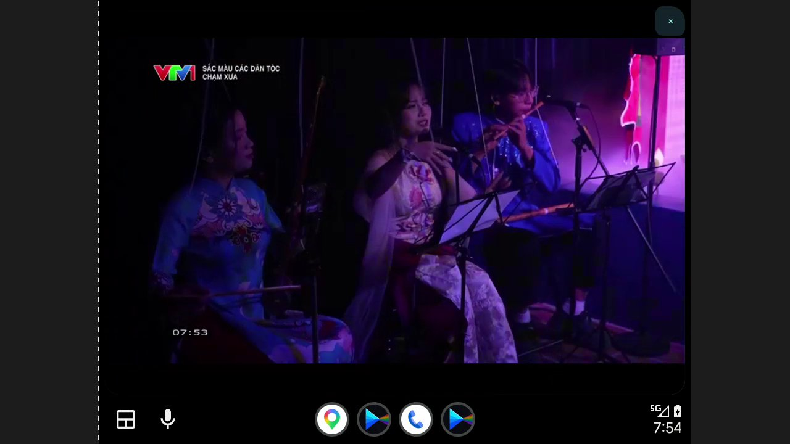
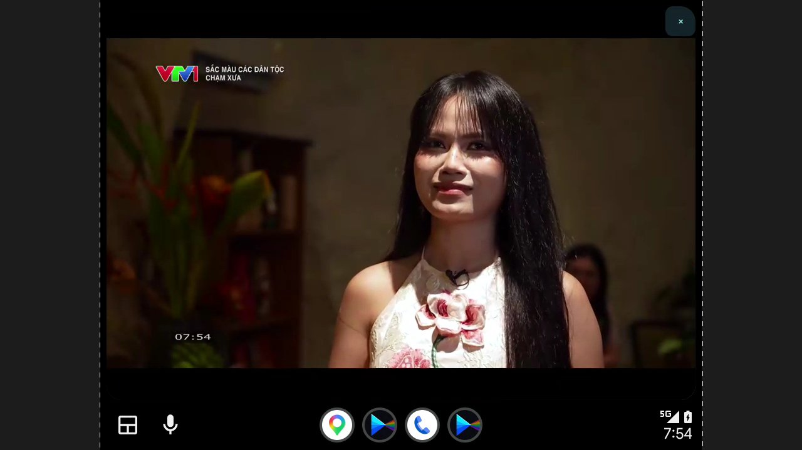
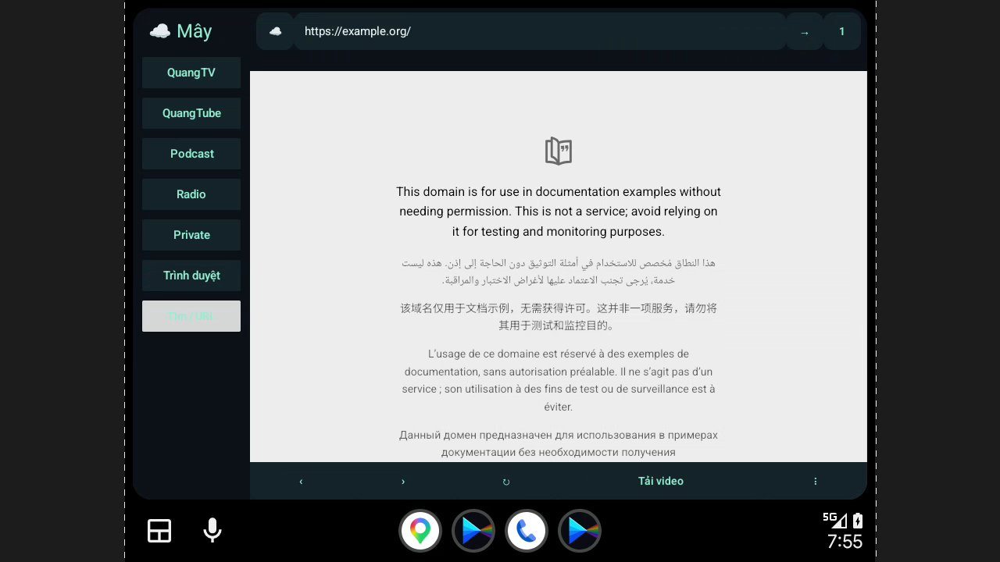

[Build 20 observations](android-auto-native-evidence/build20-result.json).

### Fullscreen fallback found after the build 20 URL fix

An extended QuangTube repeat on 20 still played clean changing video, but its in-page expanded mode sometimes retained the native task rail. That is not the same result as the rail-free 18 capture. Follow-up source 0508b8e8146217ff5f0e181ae8477e721e3037c4 adds an explicit native Toàn màn ứng dụng button. It expands the Gecko surface and hides the task rail independently of whether the website successfully enters DOM fullscreen. The existing native × restores the rail. For a video site using in-page expansion, first expand its player, then use this native app control if the rail remains. Native app expansion alone does not rewrite an arbitrary website's player layout.

## Current candidate: build 21 verified

Source 0508b8e8146217ff5f0e181ae8477e721e3037c4; [successful CI](https://github.com/Quangdevil/QuangTV/actions/runs/41370112006); [exact artifact](https://github.com/Quangdevil/QuangTV/actions/runs/41370112006/artifacts/13108543015). APK SHA256 b0ecb8b470405bdd847c52517a755b05589fb9a7cbc964d37f9b06fb022126f5. Installed as an in-place update from 20. Native app fullscreen and a readable dark search button are the only playback-UI additions after 20.

The final harness waited for launcher readiness and verified that the native Mây rail was present before issuing player taps. An earlier attempt hit another app during startup; another stopped on a too-strict RGB check despite a correct native rail. Neither is counted as a playback pass. The successful run allowed small RGB deviations from the DHU video encoding and its screenshots were visually reviewed.

- PASS: all six task buttons, search and Toàn màn ứng dụng visible on the real rendered DHU app surface.
- PASS: opened the official Blender Big Buck Bunny YouTube URL through AA search, explicitly started playback and expanded the web player. Its in-page expansion retained the rail. Pressed the **new native app fullscreen control**: rail and native browser chrome disappeared, the video occupied the AA application region, and the native × remained available.
- PASS: clean changing fullscreen frames; mean RGB difference **54.56**, verified visually as different scenes rather than merely a moving clock or corrupt pixels.
- PASS: restrict all + speed 10 replaced the entire picture with the parked-only gate. speed 0 + restrict none restored access; × restored the task rail. Playback was paused after the restriction cycle, requiring an explicit play action to continue.
- PASS: native browser home followed by example.org through AA search; the page rendered, its address correctly showed https://example.org/, and the keyboard did not reopen.
- Android crash log: 0 bytes. With documented DHU focus audio on and SDL dummy output, the receiver logged a closed audio stream with **10240 buffered samples**. No audible-quality test is claimed.

The VTV1/VTV3, Podcast, Radio and Private-entry observations above are from 18; VTV motion/fullscreen was rechecked on 19 and 20. Build 21 repeats the changed native fullscreen path with QuangTube, motion gate and URL controls. It is not a claim that all 95 channels, all YouTube videos, private sources, DRM, or browser downloads were exhaustively tested.

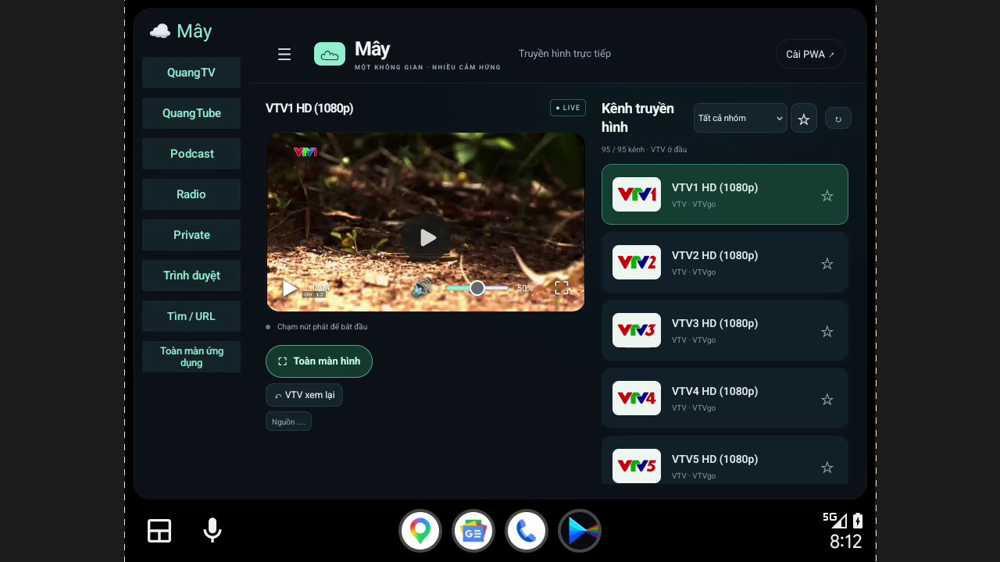
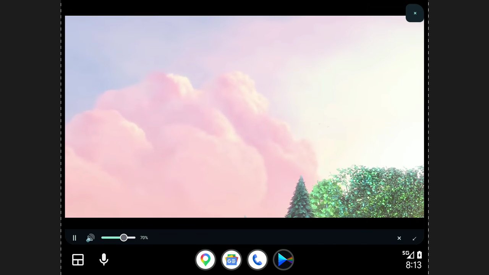
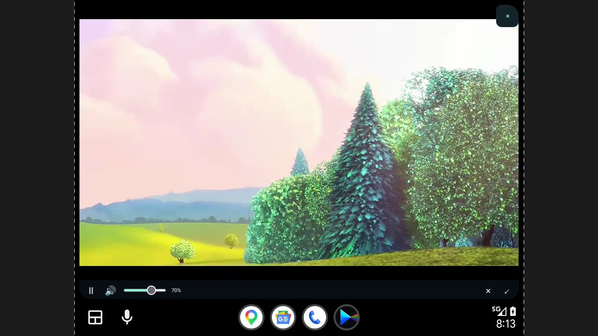
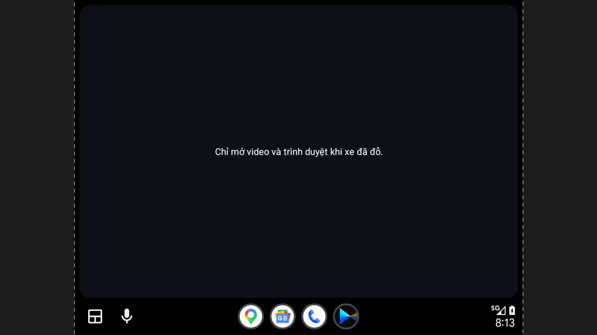
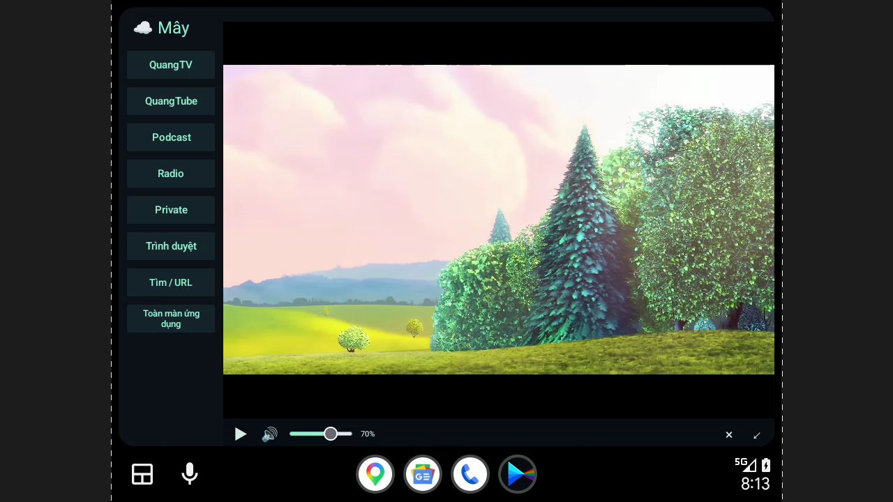
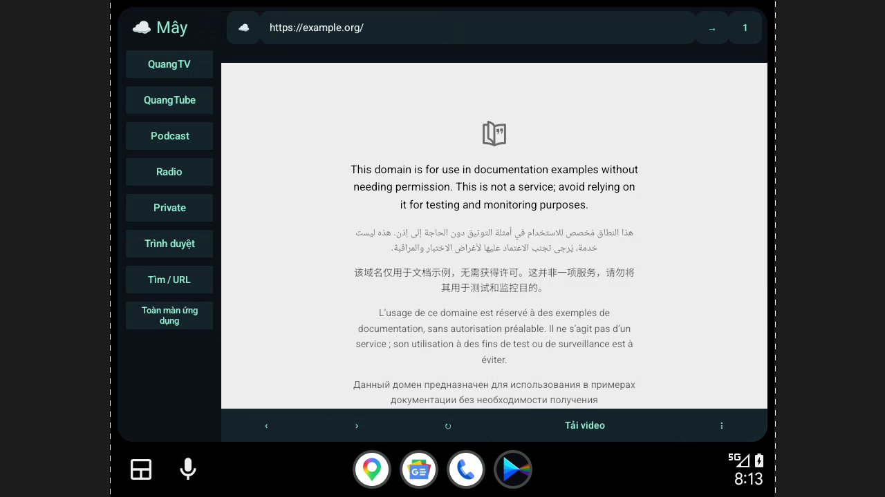

[Build 21 observations](android-auto-native-evidence/build21-result.json). The release stays an isolated preview; no production OTA or Google approval is implied.
